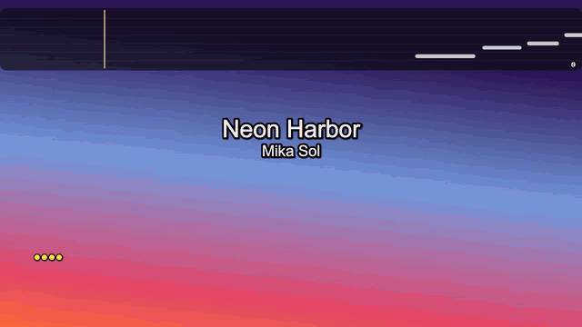
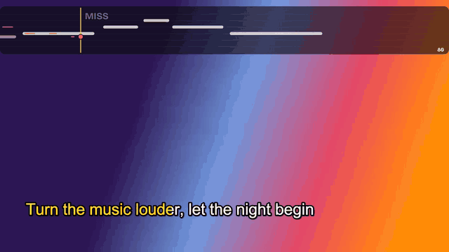
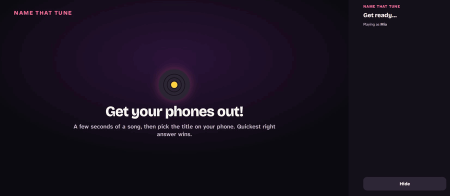
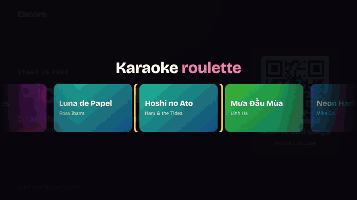
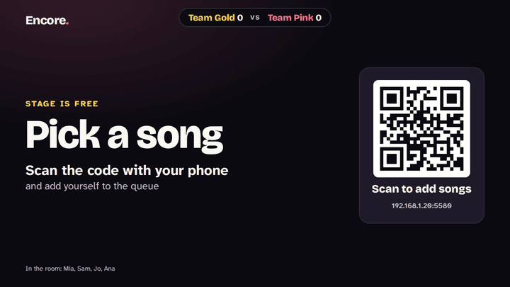

# Encore downloads

**Encore** is a karaoke party app: one device hosts the party, a TV shows the music video with the lyrics, and everyone
adds songs from their phone's browser. These are the installers. Get them from the
[latest release](../../releases/latest).

## What makes it fun

- **Phones are the remote:** scan the code, search, add your name. Duets, taking turns, a countdown to your turn.
- **Every TV in the house:** several TVs show the same party, in sync.
- **Singing scores, guide vocals and key change** for anyone who wants them.
- **Party games:** Name that tune, Finish the lyric, Sing-off, Team night, roulette, surprise rounds.
- **Album covers and profile pictures:** songs show their cover, singers their photo on the TV's Up next.
- **Open party:** everyone can pause, skip and reorder, so the host gets to sing too.
- **Each singer on their own mic:** with two or more mics, everyone gets their own score.
- **Fits your devices:** Encore lists what your setup can do and what to add (Station → System).

<table>
<tr>
<td width="50%"></td>
<td width="50%"></td>
</tr>
<tr>
<td><sub><b>Singing score.</b> The notes scroll as you sing; every word is judged, then the grade.</sub></td>
<td><sub><b>Finish the lyric.</b> The music cuts out mid-line. Keep going.</sub></td>
</tr>
<tr>
<td></td>
<td></td>
</tr>
<tr>
<td><sub><b>Name that tune.</b> A few seconds of a song, answers on everyone's phone, quickest right answer wins.</sub></td>
<td><sub><b>Karaoke roulette.</b> The TV spins and picks the song. No backing out.</sub></td>
</tr>
<tr>
<td></td>
<td></td>
</tr>
<tr>
<td><sub><b>Team night.</b> Two teams, the room rates every song, the points add up all night.</sub></td>
<td><sub><b>Comic-book screensaver.</b> Between songs the TV turns your music videos into comic pages (and spares OLED screens).</sub></td>
</tr>
</table>

**What do your TVs, tablets and mics bring, and what do they miss?** See [What your devices can do](DEVICES.md). Putting together a setup? [Build your own, for any budget](BUILD.md).

## Which one do I need?

| You want to… | Get | On |
|---|---|---|
| **Host the party** on an Android tablet or phone | `Encore-Station-<version>.apk` | Android 8 or newer |
| **Host the party** on a Windows PC or laptop | `Encore-Setup-<version>.exe` (or the portable `.zip`) | Windows 10 / 11, 64-bit |
| **Host the party** on a home server, mini PC or NAS | the Docker image `ghcr.io/alainator/encore` | Linux with Docker (x86-64) |
| **Show the party on a TV** | `Encore-TV-<version>.apk` | Android TV, Google TV, NVIDIA SHIELD, Chromecast with Google TV, Fire TV |
| **Join and add songs** | nothing to install | any phone's browser: scan the QR code on the TV |

Guests never install anything. iPhones and iPads join from the browser like everyone else.

## Installing

### Android tablet or phone (Encore Station)
1. Open the latest release on the device and tap `Encore-Station-<version>.apk`.
2. When Android asks, allow your browser to **install unknown apps**, then tap **Install**.
3. Open **Encore Station** and pick your songs folder.

### Android TV, Google TV, SHIELD, Chromecast with Google TV (Encore TV)
Easiest: once Encore Station is running, install the free **Downloader** app on the TV (Play Store), open it and
type the address the Station shows under **System → TVs → Encore TV on a friend's TV** (it ends in `/tv.apk`). Or copy `Encore-TV-<version>.apk` to the TV with a USB
stick and open it with a file manager.

### Fire TV (Encore TV)
1. Install **Downloader** from the Amazon Appstore.
2. Settings → My Fire TV → Developer options → **Install unknown apps** → turn on for Downloader.
3. In Downloader, type the address the Station shows (it ends in `/tv.apk`), or this release's
   `Encore-TV-<version>.apk` link, and install.

### Windows
1. Download `Encore-Setup-<version>.exe` and run it.
2. Windows may say **"Windows protected your PC"**: the installer isn't signed with a paid certificate. Click
   **More info → Run anyway**.
3. Encore opens in your browser; choose your songs folder. If Windows Firewall asks, allow **private networks** so
   phones and TVs on your Wi-Fi can reach it.

No installer wanted? Unzip `Encore-Windows-portable-<version>.zip` and run `Encore.exe`.

### Docker (home server, mini PC, NAS)
```sh
docker run -d --name encore --restart unless-stopped -p 5580:5580 \
  -v /path/to/your/songs:/library:ro -v encore-data:/data \
  ghcr.io/alainator/encore:latest
```
Then open `http://<that machine's address>:5580/station` on a tablet or computer to host, and point TVs at the same
address (`/tv`). Set a host PIN when the Station asks. Update with `docker pull ghcr.io/alainator/encore:latest` and
recreate the container: the party's data stays in the `encore-data` volume.

## Updating
From version 0.11 on, Encore checks this page twice a day and the Station's **System** screen says when a new version
is out, with the right download for that device (only the release's name and file list are fetched; set
`UPDATE_CHECK=0` to turn it off). Install the new version over the old one: your songs, settings and party history stay. (The Android apps update in
place because every release is signed with the same key.)

## Songs
Encore plays karaoke videos you already have (a video with lyrics, or one made by Karaoke Studio). It doesn't come with
songs and doesn't download any.
